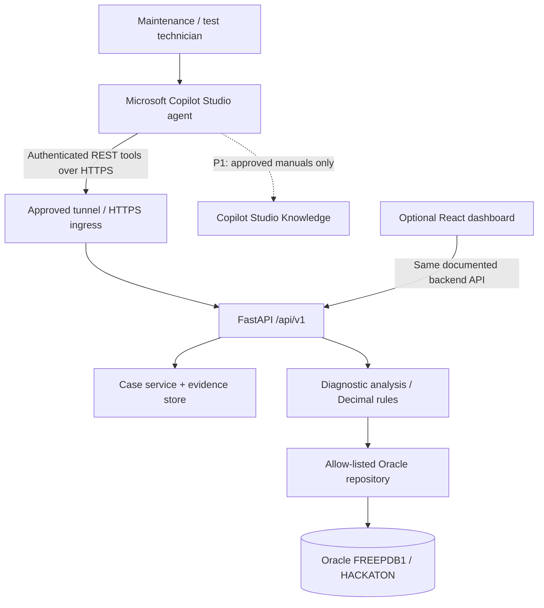

# MAGNA TRACE — Architecture v1.0 (Proposed)

> **Source of truth:** `docs/product.md` v1.4 FINAL (2026-11-10). This document specifies *how* to build that product; it does not change its P0 scope.  
> **Status:** Proposed for team review. No implementation or live Copilot integration is claimed.  
> **Target:** Four developers, 24-hour MAGNA Hackathon, Task 9.  
> **Core principle:** Copilot conducts the conversation; bounded Python services own facts, calculations, evidence and case state.

## 1. Decisions, confirmed facts and open dependencies

| ID | Selected architecture decision | Status / consequence |
| --- | --- | --- |
| AD-01 | Microsoft **Copilot Studio** is the intended primary agent; final demo may use a real test chat or published channel *if organizers accept it*. | Selected; live tool route unproved (**G0**). |
| AD-02 | REST API tools described by OpenAPI, exposed by Python **FastAPI**. | Selected; exact Copilot import format and authentication checked at G0. |
| AD-03 | **Copilot owns dialogue/tool selection**; backend owns data, numeric evaluations, evidence IDs, safe next-step candidates and assessment labels. | Selected; no second LLM orchestration layer in P0. |
| AD-04 | Allow-listed, narrow API operations; no model-generated SQL. | Selected; five core tools, one optional comparison tool. |
| AD-05 | Decimal-safe bounds analysis **and** station/serial contextual inspection. | Selected; unvalidated cross-record comparisons remain **P1**. |
| AD-06 | In-memory, isolated active cases for P0 (single backend worker). | Selected; restart loses cases; persistence is P1. |
| AD-07 | **RAG/knowledge capability** in design, only for approved documents. | Desired P1; no maintenance manuals currently verified. |
| AD-08 | React/TypeScript dashboard may be built **in parallel**, using the same read-only APIs. | Selected parallel effort; not accepted as a substitute for P0 Copilot. |
| AD-09 | Local backend exposed only through a **permitted, authenticated HTTPS tunnel**. | Selected approach; tunnel vendor, route and auth unverified. |
| AD-10 | `pytest`, independent SQL spot-checks and live Copilot E2E. | Selected. |

**Confirmed from project inspection:** Oracle `FREEPDB1`, `HACKATON` schema, four tables; measurement `COUNT(*) = 1524`, 23 distinct measurement stations, 27 distinct serials, 164 distinct measurement names; 30 rows with raw `MEASURE_FAIL_CODE = 1001`. These are previously executed SQL results, not proof of a fault or event. Approximate `NUM_ROWS` for other tables still require `COUNT(*)` checks.

**Open facts:** exact Copilot Studio harness/tenant privileges, usable connector path, demo channel acceptance, tunnel and connection authentication, Oracle read-only service account, allowed cloud data fields, `1001` meaning, timezone, units, test comparability, incident identity, and availability of approved manuals. Do not silently treat an unknown as a product decision.

**Scope reconciliation:** `product.md` v1.4 puts cross-station/serial comparison, RAG and dashboard after P0. Build adapters/contracts early if inexpensive, but disable incomplete paths and do not extend P0 acceptance criteria without an explicit team decision recorded in `docs/decisions.md`.

## 2. System context and boundaries



**Trust boundaries:** Copilot and the public HTTPS endpoint are external to the laptop; FastAPI is the access-control and validation boundary; Oracle credentials and raw dumps never leave the backend. Neither the agent nor the dashboard contacts Oracle directly. The dashboard does not expose an additional LLM service.

**Runtime:** Oracle Docker container; Python FastAPI process bound locally; HTTPS tunnel forwards only the guarded API; separate local Vite/React development server. Run one FastAPI worker while cases are in-memory; multiple workers would split the case store.

## 3. Responsibility split and principal components

| Component | Owns | Explicitly does not own |
| --- | --- | --- |
| Copilot agent (`copilot/`) | Intent, tool selection, concise wording, one clarification, source presentation | SQL, arithmetic, diagnosis certainty, evidence ID generation |
| HTTP/API (`backend/app/api.py`) | Request validation, auth, error mapping, bounded response, request IDs | Diagnostic conclusions |
| Oracle repository (`oracle_repo.py`) | Parameterized allow-listed SELECT queries, row limits, stable ordering, connection handling | Schema mutation, unrestricted query execution |
| Measurements (`measurements.py`) | Parse raw strings with `Decimal`, compare bounds, flag data quality, compute deviations | Interpret unverified fault codes as PASS/FAIL |
| Investigation (`diagnostics.py`) | Build snapshot, collect supported alternative hypotheses, propose verification/clarification candidates | Confirm physical root cause from limited data |
| Cases/evidence (`cases.py`, `evidence.py`) | Case lifecycle, snapshots, answer provenance, case-local references, handover | Replace prior observations with user claims |
| Comparison (`comparisons.py`, P1) | Compare records only where scope, units and test semantics are validated | Forced comparisons or numeric root-cause probabilities |
| Optional dashboard (`frontend/`) | Read-only context, anomalies, evidence drill-down, optional technician interaction | Competing independent investigation engine |
| Optional knowledge (`copilot/knowledge/`, P1) | Search approved manuals with visible source metadata | Manufacture approved procedures or repairs |

**No code reuse dependency on Standalone Coding Agent:** carry over its bounded-context, explicit-provider and evidence-audit principles; do not import its Git/edit/CLI runtime.

## 4. Copilot Studio integration — G0 first

1. Open the actual TUKE/available Copilot Studio environment and record its agent type, permissions, and whether its **REST API tool** wizard is available. Confirm with organizers whether a live Studio test chat counts as the final channel.
2. Expose a minimal guarded `/api/v1/health/echo` tool through a *permitted* HTTPS tunnel, using a non-sensitive value and fresh `request_id`. Do not make it an unauthenticated production route.
3. Import a minimal OpenAPI specification; check whether this environment accepts OpenAPI 3 directly or requires Swagger/OpenAPI 2 conversion. **FastAPI's generated 3.x spec is not automatically guaranteed to import unchanged.**
4. Configure the authentication mechanism actually supported in the tenant. Prefer an authenticated header-based connection for the hackathon if permitted; never put secrets in OpenAPI source, prompts or Git. Some configurations prompt the maker/user for a key; test the actual connection flow. Do **not** leave a public endpoint unauthenticated.
5. Invoke the tool from the real agent chat, match `request_id` in Copilot output and backend logs, then repeat with a **live Oracle-derived value**. Verify that it is not mocked, pasted or cached demo text.
6. Record tool name, connector type, spec version, auth method, accessible channel, tunnel route class and evidence of both calls in `docs/decisions.md` (never record secrets). If blocked, consult mentors immediately; React-only demo does **not** meet the confirmed Copilot requirement.

**G0 pass:** real Copilot → authenticated HTTPS → live FastAPI → Oracle response, with matching request and value. Testing locally via Swagger or curl alone is not a pass.

## 5. Narrow tool/API contract

**Namespace:** `/api/v1`. Types validated by Pydantic; `station_number` / `serial_number` are values, never dynamic table or column names. Limits enforced server-side. Tool descriptions tell Copilot when *not* to call a tool.

| Copilot tool / REST operation | Required input | Successful output | Stage |
| --- | --- | --- | --- |
| `list_stations` — `GET /stations` | optional `q`, bounded `limit` | known station IDs and availability counts | P0 |
| `open_case` — `POST /cases` | `station_number`; optional `from`, `to`, `serial_number` | `case_id`, `request_id`, snapshot, suggested question/verification | P0 |
| `get_evidence` — `GET /cases/{case_id}/evidence/{evidence_id}` | two case-local identifiers | captured raw source fields, calculation inputs, retrieval timestamp | P0 |
| `record_answer` — `POST /cases/{case_id}/answers` | `question_id`, technician answer text | updated snapshot, new report evidence ID, change summary | P0 |
| `get_handover` — `GET /cases/{case_id}/handover` | `case_id` | source-grounded summary, unanswered questions, next step | P0 |
| `compare_case` — `POST /cases/{case_id}/comparisons` | mode, approved measure, optional serial/station context | comparison with sample sizes or `NOT_COMPARABLE` | P1; only if validated |

**Support endpoints:** `GET /healthz` for minimal local process health; `GET /readyz` for restricted Oracle readiness; `GET /openapi.json` for developer use only. The `health/echo` G0 endpoint is development-only and must not survive as an unguarded public tool.

**Common response:** `request_id`, `retrieved_at`, `status`, `case_id` if applicable, plus bounded `data` or structured `error`. Errors use stable codes: `INVALID_SCOPE`, `NO_DATA`, `SOURCE_UNAVAILABLE`, `TIMEOUT`, `EVIDENCE_NOT_FOUND`, `EVIDENCE_NOT_IN_CASE`, `NOT_COMPARABLE`, `CASE_EXPIRED`, `UNAUTHORIZED`. Never substitute invented values after errors.

**Snapshot fields:** validated station/time/serial scope; top findings (`measurement`, `raw_value`, `raw_bounds`, `parsed_value`, `deviation`, `unit_if_known`, independent range/quality/code statuses, `evidence_id`); `UNDETERMINED` assessment unless validated evidence supports more; one next action/question and its basis; warnings; `case_id`, `request_id`, retrieval time. Cap primary findings to five; drill-down retrieves others.

## 6. Oracle and numeric data design

- Read through `python-oracledb` to `FREEPDB1`, ideally with a dedicated user holding **SELECT only** on required `HACKATON` tables. Never use `SYSTEM` as the runtime credential. Use local secrets/environment variables, not source-controlled `.env`.
- The authoritative P0 records come from `SNO_MEASUREMENT_DATA`. `MACHINE_LINES`, `SNO_BOOKINGS_WP` and `WORKORDERS` provide context only after their relationships and keys are verified; do not join solely because names look similar.
- On `open_case`, enforce validated station ID, optional scoped time/serial filters, bound row limit, and explicit order (`BOOK_STAMP` plus deterministic tie-break/captured ordinal). Return real row counts and truncation/coverage warnings.
- Store raw `MEASURE_VALUE`, `LOWER_LIMIT`, `UPPER_LIMIT`, `UNIT`, `MEASURE_FAIL_CODE` and source context. Parse numeric strings with `Decimal`; reject ambiguous formatting, NaN/infinity, invalid/reversed/missing bounds.
- Treat equality as within recorded bounds **provisionally** pending MAGNA confirmation. Separate: `ABOVE | BELOW | WITHIN_RECORDED_BOUNDS | NOT_EVALUABLE`; quality flags; *raw* fail code (`1001`, `NULL`, other). A code never overrides the numerical comparison.
- Calculation: upper deviation = value − upper; lower deviation = lower − value. Keep units only if known; preserve precision and original inputs. Neither `NULL` nor `1001` has an assumed PASS/FAIL meaning.
- P0 analysis of station + serial: filter and summarize records by validated station and serial independently. Do not infer one event, repair or causal chain from coincident timestamps.

**Optional P1 comparison modes:** (a) `same_station_across_serials`, (b) `same_serial_across_stations`. Require matching measure semantics, units/limits, product or work-order comparability, scope and enough independent observations. Show counts/coverage, missing data and direction of differences. Different station test types, nonvalidated joins or uncertain units ⇒ `NOT_COMPARABLE`, not a forced conclusion.

**Data-baseline gate:** retain independently rerunnable `COUNT(*)`, distinct-station/serial, units, raw-code and row-uniqueness queries in `docs/data-baseline.sql` or a brief evidence note. Confirm the demo station and actual source fields before hardcoding any sample output.

## 7. Evidence, assessment and active-case state

**Classes:** `OBSERVED`, `CALCULATED`, `TECHNICIAN_REPORTED`, `HYPOTHESIS`, `UNKNOWN`. Backend generates opaque, case-local evidence IDs (`E-<case>-<n>`); the agent must never generate or alter them.

**No trustworthy unique row key is established yet:** case evidence stores an immutable *captured source snapshot* (table, queried scope, original fields, timestamp, retrieval time, captured row ordinal/fingerprint), not merely a fragile lookup by station+serial+time. If a database primary key is validated later, add it; a hash is not proof of database uniqueness. `get_evidence` resolves **the captured snapshot**, rejects foreign IDs and never silently swaps in later data.

**Case model (in memory):** `case_id`, optional authenticated actor scope, query scope, immutable observations and calculations, current hypotheses, offered `question_id`, answers with attribution/time, suggested next action, retrieval status, `created_at` / `updated_at`. Random unguessable case IDs; bounded size, expiry and locking. One worker for P0. If user identity is unavailable with shared connector credentials, **do not claim per-user isolation**; restrict to controlled single-user demo until identity binding is verified.

**State transitions:** `OPENED` → `EVIDENCE_LOADED` (or `NO_DATA`/`SOURCE_ERROR`) → `AWAITING_CLARIFICATION` → `ANSWER_RECORDED` → `NEXT_CHECK_OR_ESCALATE` → `HANDOVER_READY`. Repeated answers retain attribution; never overwrite Oracle observations. A restart invalidates in-memory cases and must be reported as `CASE_EXPIRED` (not a fabricated recovery).

**Assessment policy:** P0 defaults to `UNDETERMINED`. Report competing equipment/product explanations as **unverified hypotheses** and make it explicit what independent evidence would distinguish them. Technician reports and naive sample thresholds do not authorize `EQUIPMENT_LIKELY`, `PRODUCT_LIKELY` or `MIXED`. Any stronger label requires a separately reviewed, tested rule and verified comparative evidence; otherwise stay undetermined.

**Next action:** backend chooses a safe data-check / clarification / escalation candidate; Copilot may paraphrase it without changing its meaning. No physical repair, replacement, machine adjustment or specific procedural instruction without an approved SOP reference.

## 8. Optional document knowledge / RAG (P1)

**Preferred hackathon route:** use Copilot Studio **Knowledge** with approved MAGNA PDF/DOCX/manual content, if available and permitted in the tenant. It avoids maintaining a second embedding store or Python vector service; check knowledge-source capabilities and source citation behavior in the actual agent. File knowledge can depend on tenant Dataverse configuration and access permissions.

**Source requirements:** each retrieved procedural statement must identify document title, revision, page/section (when available) and provenance; if the platform cannot expose sufficient source detail, mark the response as general guidance, **not** an approved MAGNA repair procedure. Uploaded knowledge may be accessible to agent users according to tenant configuration; secure approval is mandatory before uploading internal manuals.

**Fallback (only if needed):** backend `knowledge_search` with approved, versioned local documents and bounded lexical retrieval; expose it as an additional tool after P0. No unapproved web pages, fabricated SOPs or invented source citations. The provided `how_to_install.md` describes Oracle setup and is **not** an equipment repair manual.

**No documents available:** knowledge feature disabled; Copilot explicitly says `NO_APPROVED_DOCUMENTS` and offers data verification/escalation. No dependency on RAG to pass P0.

## 9. Optional parallel React dashboard (P1)

Vite + React + TypeScript. Use the same FastAPI contracts and consistent evidence semantics; show station selector, anomaly table, measured bounds, serial filter, evidence detail and optional case summary. A minimal local dashboard is useful for screenshots and debugging, but **not the canonical agent interface**. No separate diagnostic classification logic in TypeScript.

Run the dashboard locally with a dev proxy; any externally accessible UI needs real access control and CORS allow-listing. No API keys or Oracle credentials in browser code. If UI work threatens G0/P0, freeze it; its existence does not substitute for Copilot.

## 10. Deployment, authentication and security

1. **Oracle:** Docker container with the listener bound to `127.0.0.1:1521` on Windows. Its persistent volume and archives stay outside the repository.
2. **Backend:** Python FastAPI on loopback, configured with a read-only Oracle connection, strict timeout/row limits, one worker and redacted request logging.
3. **Tunnel:** organizers-approved HTTPS tunnel exposing **only** guarded FastAPI endpoints; validate provider policy, TLS, authentication, hostname stability and connector reachability. Do not expose database port, Swagger UI, debug endpoints or secrets.
4. **Auth:** G0 chooses a mechanism compatible with this Copilot agent (e.g. an `X-API-Key` header held in a protected connector connection, or a supported OAuth flow). A key authenticates the caller but does not prove which technician is talking. **Fail closed** if connector authentication is unavailable; consult mentors, not `auth=None` on a public tunnel.
5. **Data minimization:** send only necessary measurement fields to the approved agent/model route. The mentors' allowance to use arbitrary LLMs during development is **not** blanket authorization to upload confidential data. Do not commit exported rows with sensitive identifiers, credentials, tunnel tokens or Oracle dump archives.
6. **Input isolation:** treat technician text, tool outputs and retrieved documents as untrusted content. No filesystem access, `eval`, shell commands or unrestricted SQL from a prompt. Rate-limit and constrain body size; close the public route after the demo.

## 11. Suggested repository and code boundaries

```text
codexsfunclub/
├── README.md
├── AGENTS.md
├── docs/
│   ├── product.md                 # approved v1.4; never silently edit
│   ├── architecture.md            # this design
│   ├── plan.md                    # ownership, tasks and gates (next)
│   ├── decisions.md               # G0 choices and scope changes
│   └── data-baseline.sql          # independently reproducible SQL (planned)
├── backend/
│   ├── app/
│   │   ├── main.py                # FastAPI bootstrap
│   │   ├── api.py                 # REST routes + request validation
│   │   ├── schemas.py             # shared request/response contracts
│   │   ├── oracle_repo.py         # allow-listed SQL
│   │   ├── measurements.py        # Decimal / bounds
│   │   ├── diagnostics.py         # snapshot and next checks
│   │   ├── evidence.py            # source snapshots + IDs
│   │   ├── cases.py               # in-memory sessions
│   │   └── comparisons.py         # P1 guarded comparisons
│   └── requirements.txt
├── copilot/
│   ├── instructions.md            # orchestration + safety rules
│   ├── openapi.json               # actual G0-tested compatible spec
│   └── setup.md                   # tenant / connector config (no secrets)
├── frontend/                      # parallel P1 React dashboard if delivered
└── tests/                         # pytest, E2E checklist and fixtures
```

**Ownership for planning:** (A) Oracle/measurements; (B) backend/cases/evidence; (C) Copilot integration/auth/tunnel; (D) frontend plus independent verification. All four must support integration, demo and documentation. These are responsibility areas, not final task assignments.

## 12. Tests, gates and definition of done

| Gate | Checks / proof | Outcome if failed |
| --- | --- | --- |
| **G0 — live Copilot** | Real authenticated REST tool invocation and second live Oracle-derived result; matching request IDs/logs | Escalate, block claims of completed P0; do not replace with mock UI |
| **G1 — Oracle correctness** | `COUNT(*)` baseline; station/serial queries; independent SQL check of ≥3 values; `Decimal`, equality, bad limits, unknown code, `NULL` | Fix parsing/query source; unsupported joins disabled |
| **G2 — diagnostic case** | Open → evidence resolution → one question → `TECHNICIAN_REPORTED` answer → updated next action → handover | Keep scope to one trustworthy station |
| **G3 — integration & safety** | Two live demonstrations; invalid/foreign evidence ID; no data; Oracle timeout; prompt injection; authenticated tunnel; no secrets | Freeze optional features; fix blockers |
| **P1 readiness** | Comparable serial/station fixtures; approved manual source citations; optional dashboard uses same data | Feature stays disabled and clearly labelled |

**Test strategy:** `pytest` for deterministic analysis and case isolation; FastAPI tests with mocked Oracle repository; SQL spot checks against the actual supplied DB; live Copilot tool/credential tests cannot be replaced by unit tests. Include an in-range row carrying `1001` and show `WITHIN_RECORDED_BOUNDS` plus raw unknown code without calling it PASS. Track individual assertions and independent expected outputs, not only a green test count.

**Release acceptance:** the `product.md` v1.4 five P0 capabilities work end-to-end, twice, from the actual Copilot environment; each reported number resolves to captured evidence; an unanswered cause remains `UNDETERMINED`; no invented maintenance procedure; real failures are exposed honestly. P1 deliverables are never counted as P0 substitutes.

## 13. Open choices before implementation

- **G0:** exact Copilot Studio agent harness, REST API import compatibility, available authenticated connection mode, accepted final channel and tenant permission.
- **G0:** permitted tunnel vendor, URL lifetime, external reachability and cloud-data policy.
- **G1:** SELECT-only Oracle account, stable query scope/row ordering, actual units, timestamp semantics, bound equality, code `1001`, allowed cross-record keys.
- **G1:** whether genuinely approved manual/SOP files exist and can be safely attached to Copilot Knowledge.
- **Team:** how much frontend work may run in parallel without starving G0/P0; assign owners in `docs/plan.md`.

**Decision policy:** verify external platform facts through G0/G1; record implementation changes in `docs/decisions.md`. Update `product.md` only if the team explicitly changes product scope.

## Technical references (environment-dependent, checked 2026-11-10)

- Microsoft Learn — [Extend your agent with tools from a REST API (preview)](https://learn.microsoft.com/en-us/microsoft-copilot-studio/agent-extend-action-rest-api). Standard harness documents OpenAPI v2 import/translation; verify actual tenant behavior.
- Microsoft Learn — [Add a REST API as a tool (Customer Conversation) (preview)](https://learn.microsoft.com/en-us/microsoft-copilot-studio/agents-experience/tools-add-rest-api-customer-conversation). That harness lists Swagger 2.0 and OpenAPI 3.0; availability varies.
- Microsoft Learn — [Upload files as a knowledge source](https://learn.microsoft.com/en-us/microsoft-copilot-studio/knowledge-add-file-upload). Permissions, supported types and Dataverse prerequisites apply.
